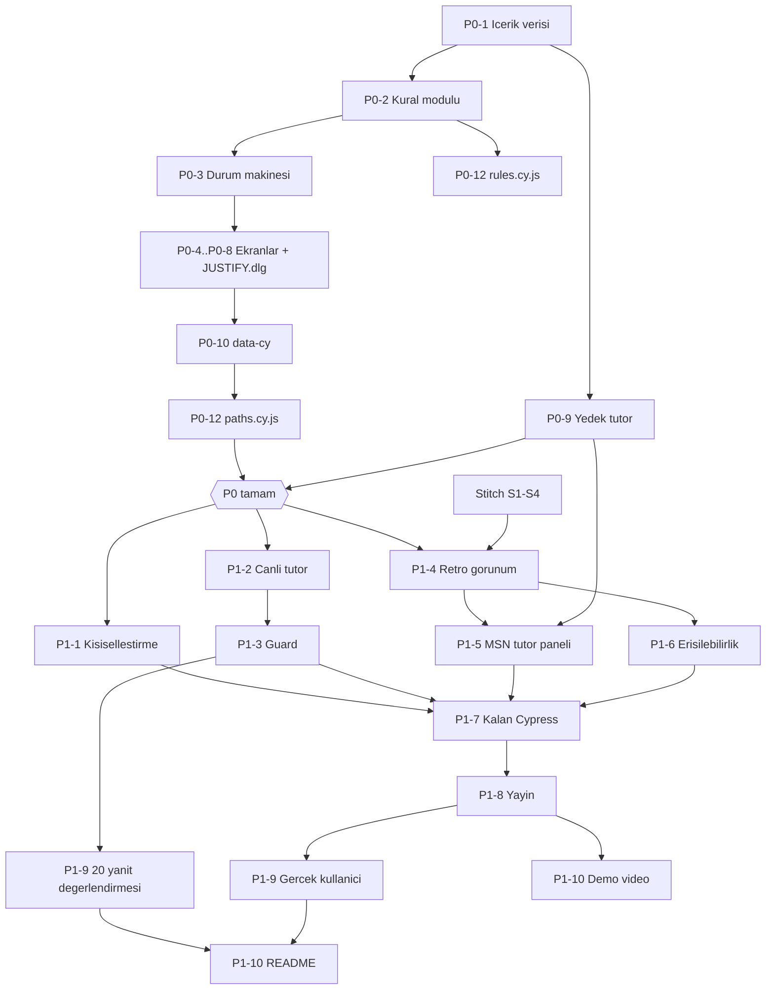

# HUMAN.exe — Uygulama Kontrol Listesi

Kaynak: `spec.md` v2.1 ve `flow.mmd`. Kapsam dondurulmuştur; bu listede spec dışında özellik yoktur. Bölüm numaraları (§) `spec.md`'ye aittir.

**Temel kural:** Karar mantığı (kural modülü) UI'dan ayrıdır. Win95 masaüstü ve MSN tarzı tutor yalnızca sunum katmanıdır; kararları, seçenek sırasını, bayrakları, saati veya sonu değiştiremez.

---

## 1. Çalışan ilk sürüm için zorunlu (P0)

| # | Görev | § |
|---|---|---|
| P0-1 | **İçerik verisi** (`content/`): 3 karar, 6 seçenek (`option_id`, ekran metni, konum, saat maliyeti, bayrak), 6 sonuç metni, 9 gerekçe + uyumlu olan, kanıt kartları, ASSIST.exe önerileri, ilkeler, 3×3 ipucu merdiveni | §6, §8.1 |
| P0-2 | **Kural modülü** (saf fonksiyonlar, UI'sız): seçim → bayrak, saat hesabı, son = `flags.length === 0 ? SAFE_RECOVERY : UNSAFE_RECOVERY` | §6, §7 |
| P0-3 | **Durum makinesi**: `START → PROFILE → D{n}_DECIDE → D{n}_JUSTIFY → D{n}_CONSEQUENCE → REPORT`, `RESTART`; onay sonrası kilit; yenileme → `START` | §10 |
| P0-4 | **S1 Profil**: 3 soru; üçü seçilene kadar `Başlat` devre dışı | §8, AE1 |
| P0-5 | **S2 Karar**: kanıt kartları, ASSIST.exe önerisi, 2 seçenek (spec'teki sabit konumlarla), `Kararı Onayla` | §6 |
| P0-6 | **`JUSTIFY.dlg`**: S2 üzerinde modal; 3 radyo (sabit sıra), `Tamam` seçimden önce devre dışı; `X`/arka plan/Esc kapatmaz | §6.1, AC-13 |
| P0-7 | **S3 Sonuç**: sonuç metni, ilke, `Devam` | §6 |
| P0-8 | **S4 Rapor**: son, yalnızca tetiklenen bayraklar, 3 karar × seçim/gerekçe/uyum/sonuç, sabit uyarı metni, `Yeniden başlat` | §7 |
| P0-9 | **Tutor (yalnızca yedek mod)**: `İpucu iste` merdiveni + anahtar kelime eşlemeli hazır yanıtlar; rozet `KURAL TABANLI YEDEK` | §9.1, §9.5 |
| P0-10 | **`data-cy` seçicileri** tüm etkileşimli öğelerde | §12 |
| P0-11 | **Temel mobil yerleşim**: 360×640'ta yatay kaydırma yok, dokunma hedefi ≥ 44 px | §11 |
| P0-12 | **Cypress `paths.cy.js` + `rules.cy.js`**: 8 yol, ortak `cypress/fixtures/paths.json` | §13, AC-14 |

**P0 bitti sayılır:** 8 yolun tamamı yedek mod tutor ile baştan sona oynanabiliyor ve `paths.cy.js` gerçekten çalıştırılıp geçiyor.

---

## 2. Çekirdek akış çalıştıktan sonra eklenecekler (P1)

Sıra önceliğe göredir. Hepsi spec'te tanımlıdır; yeni özellik değildir.

| # | Görev | § |
|---|---|---|
| P1-1 | **Kişiselleştirme**: seviye (ipucu basamağı 3/2/1, sözlük, sonuç derinliği), rol (sabitlenen kart, tutor çerçevesi), hedef (ODAK rozeti, genişletilmiş rapor, yansıtma sorusu); profil rozeti | §8 |
| P1-2 | **Canlı tutor (Gemini / Google AI Studio)**: sistem istemi (profil + karar + kanıt + sözleşme; güvenli seçenek bilgisi verilmez), 8 sn zaman aşımı → yedek mod, `CANLI AI` rozeti; istem sürümü `tutor/` altında | §9.1, §9.5 |
| P1-3 | **Guard** (tamamlayıcı önlem): `tutor/forbidden-terms.json`, eşleşmede sıradaki ipucu, `guard_triggered` sayacı | §9.3 |
| P1-4 | **Retro görünüm**: Win95/98 pencereleri, görev çubuğu + simüle saat, Başlat menüsünden restart (onaylı) | §11 |
| P1-5 | **MSN tarzı tutor paneli**: mesaj balonları, yazıyor göstergesi, alttan açılan panel; `JUSTIFY.dlg` açıkken açılamaz | §11, AC-13 |
| P1-6 | **Erişilebilirlik**: WCAG AA kontrast, ≥ 16 px gövde metni, bayraklarda simge + metin | §11 |
| P1-7 | **Kalan Cypress grupları**: `onboarding`, `personalization`, `tutor` (stub/guard/yedek), `flow`, `responsive` | §13 |
| P1-8 | **Yayın**: Google AI Studio'da mobil erişilebilir bağlantı; API anahtarı depoda yok | §17 |
| P1-9 | **Değerlendirme**: 20 yanıt + manuel anlamsal inceleme; 1 gerçek kullanıcı oturumu | §14 |
| P1-10 | **Teslim belgeleri**: `DESIGN.md` (Stitch S1–S4), `README.md` (3 dışlanan özellik, gerçek test çıktısı), 60 sn demo | §11, §15, §16 |

---

## 3. Teslimden önce doğrulanması zorunlu kabul kriterleri

Her madde **gerçekten çalıştırılıp** kanıtı (test çıktısı, ekran görüntüsü veya kayıt) depoya eklendikten sonra işaretlenir.

**Karar mantığı**
- [ ] 8 yolun her biri beklenen son ve bayrak kümesini üretir (UI + kural modülü, aynı fixture) — AC-14
- [ ] AE2: `D1_ROLLBACK_NOW` → `JUSTIFY.dlg` → `ARCH_RISK`, saat 08:25, D2'ye yalnızca `Devam` ile
- [ ] AE3: tamamen güvenli yol → `SAFE_RECOVERY`, bayrak listesi boş
- [ ] AE4: yalnızca D3 riskli → `UNSAFE_RECOVERY`, yalnızca `PRIVACY_RISK`
- [ ] AC-7: onay sonrası seçim değiştirilemez; geri tuşu kararı değiştirmez
- [ ] AC-13: `JUSTIFY.dlg` gerekçesiz kapanmaz; açıkken tutor açılamaz
- [ ] AC-6: restart tüm bağlamı temizler; yenileme → `START`

**Kişiselleştirme**
- [ ] AE1: eksik profilde `Başlat` devre dışı; rozet, sabitlenen kart, sözlük, ODAK rozeti doğru
- [ ] AC-9: ipucu basamağı sayısı seviyeye göre 3/2/1
- [ ] AC-10: aynı seçimler 3 farklı profilde aynı son ve bayrakları üretir

**Tutor**
- [ ] AE5: stub'lanmış sızdıran yanıt gösterilmez, yerine ipucu + soru gösterilir (guard mekanizması testi)
- [ ] AC-8: ağ hatasında `KURAL TABANLI YEDEK` rozeti ve yanıt devam eder
- [ ] AC-11: D1 sonrası açıklama D2 cevabını içermez
- [ ] 20 yanıtın tamamında ham **ve** gösterilen çıktı manuel anlamsal incelemeden geçti; guard FN/FP sayıları raporlandı
- [ ] Manuel incelemeye göre gösterilen sızıntı = 0/20 ve Sokratik ≥ 18/20 — **değilse** revize edildi, 20 satırın tamamı yeniden çalıştırıldı, iki sürüm de saklandı
- [ ] README, guard'ı sızıntı olmadığının kanıtı olarak sunmuyor

**Görünüm ve teslim**
- [ ] AC-12: 360×640 ve 768×1024'te yatay kaydırma yok
- [ ] Stitch'te ≥ 3 mobil ekran (S1, S2, S4 zorunlu) `DESIGN.md`'de
- [ ] Yayın bağlantısı gerçek bir mobil cihazda açıldı ve bir yol tamamlandı
- [ ] Gerçek kullanıcı oturumu yapıldı ve `eval/real-user.md` gözlemlerle dolduruldu (uydurma sonuç yok)
- [ ] README: 3 dışlanan özellik, kurulum, test komutu, gerçek test çıktısı
- [ ] 60 sn demo videosu kaydedildi, bağlantı README'de
- [ ] `flow.mmd` ile `spec.md` §10 diyagramı birebir aynı
- [ ] Teslim tarihi ders platformundan teyit edildi

---

## 4. Adımlar arası bağımlılıklar

**Kritik bağımlılık notları**
- Kural modülü (P0-2) ve `paths.json` fixture'ı her şeyden önce gelir; UI ve tüm testler bunlara dayanır.
- Stitch tasarımı P0'ı engellemez (P0 sade yerleşimle çalışır) ancak retro görünümden (P1-4) önce bitmelidir.
- Canlı tutor (P1-2), yedek tutor (P0-9) çalışmadan başlamaz; yedek mod her zaman geri dönüş yoludur.
- 20 yanıtlık değerlendirme, istem ve guard **dondurulduktan** sonra yapılır; sonradan istem değişirse değerlendirme yeniden çalıştırılır.
- Gerçek kullanıcı oturumu ve demo, yayınlanmış sürüm üzerinde yapılır.
- Zaman yetmezse yalnızca görsel cila (P1-4/P1-5'teki animasyon ve süs ayrıntıları) sadeleştirilir; pencere yapısı, `JUSTIFY.dlg` ve sohbet paneli işlevsel olarak kalır. Ödev gereksinimi olan maddeler (kişiselleştirme, canlı tutor, değerlendirme, Cypress, yayın, demo, README) kesilmez.
